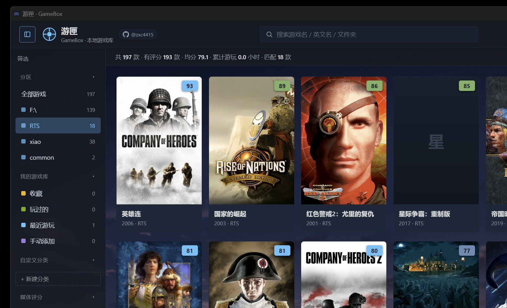

# 游匣 GameBox

> 把散落在各个硬盘里的游戏，收进一个属于自己的书架。

游匣是一款 **Windows 桌面游戏库管理器**：扫描本地目录，自动补齐中文名、媒体评分、封面与简介，用 Steam 风格的卡片墙浏览、启动和管理游戏，并记下每一局的时长。

**免登录、无账号、不上传任何数据**，所有配置与记录都留在你自己的电脑上。

<p align="center">
  
  
  
  
</p>



**作者 [@zxc4415](https://github.com/zxc4415)** · [仓库](https://github.com/zxc4415/GameBox) · [下载](https://github.com/zxc4415/GameBox/releases)

---

## 1. 发行形态

| 形态 | 文件 | 说明 |
|---|---|---|
| 单文件便携版 | `GameBox-Portable-v1.0.exe` | **单个 exe，免安装**。放在桌面、文档或 U 盘里双击即可运行；配置、缓存、壁纸都写在 exe 旁边，拷走 exe 就带走了整个游戏库 |

程序**不内嵌浏览器运行时**，界面借用系统已安装的 Microsoft Edge / Chrome，因此体积很小（约 37 MB）。本项目仅交付现成 exe，不提供源码编译入口与安装程序。

**运行要求**：Windows 10 / 11，且已安装 Microsoft Edge 或 Google Chrome。找不到浏览器时会给出提示并退出。

> 便携版请放在有写入权限的目录。若放在 `C:\Program Files` 等受保护位置，程序会自动把数据改存到 `%APPDATA%\游匣\`。

### 第一次打开

1. 下载并双击便携版，稍等片刻出现一个**无地址栏的窗口**。
2. 打开右上角「设置」→「游戏库」，添加你的游戏目录，点「保存并重新扫描」。
3. 每个扫描路径下的**一级子文件夹**被识别为一款游戏；游戏名、评分、封面会自动补全。
4. 悬停卡片点「启动」，或点开卡片查看商店式详情页。

内置的默认扫描路径是 `F:\`、`F:\xiao`、`F:\RTS`、`F:\SteamLibrary\steamapps\common`，请改成自己的目录。

---

## 2. 它能做什么

### 浏览

- 卡片墙 / 列表双视图，顶栏一键切换
- 中文名、英文名、路径搜索；按分区、评分档、收藏、玩过的、最近游玩、手动添加、自定义分类筛选
- 六种排序：评分降序 / 升序、名称、发行年份、最近启动、累计时长
- 商店式详情：头图、竖版封面、媒体均分、简介、开发商、发行日期、游玩数据、本地路径
- 明暗双主题，图片 / MP4 动态壁纸（强度可调）
- 应用窗口内**屏蔽右键菜单与图片拖拽**，观感更接近原生客户端

### 记录

- 启动游戏后在后台跟踪进程，退出时把时长累加到该游戏；不足 10 秒的会话忽略（启动失败 / 闪退）
- 记录累计时长、最近启动时间、启动次数，在卡片角标、列表、详情、统计栏与关于页同步显示
- 收藏星标、自定义分类、每款游戏可挂多张截图
- **收进系统托盘后计时不中断**：跟踪与累加都在 Qt 主进程里，隐藏界面不会重置正在进行的会话；卡片与详情显示「● 正在游玩」并实时走秒

### 整理

- 任意多个扫描路径，分区名由路径派生；自动跳过系统目录与常见工具目录
- 一键导入 Steam 库（读 `libraryfolders.vdf` 与 `appmanifest_*.acf` 补全 App ID）
- 手动添加任意 `.exe` / `.lnk` / `.bat` / `.cmd`，不依赖目录结构
- 启动文件可手动指定或恢复自动检测
- 安全卸载：移入 Windows 回收站，可随时还原；手动添加的游戏只从库中移除，不碰硬盘文件
- 内置 206 款游戏元数据（中文名、英文名、年份、Metacritic 均分、Steam App ID），未收录的联网匹配
- 「补全封面与简介」批量拉取 Steam 商店的简介、类型、开发商与发行日期

### 系统

- 单实例运行：重复启动只会把已有界面调回前台
- 系统托盘：双击恢复界面，菜单含显示主界面 / 重新扫描 / 退出
- 开机自启动（写当前用户启动项，无需管理员权限）
- 置顶的原生文件选择框，选完前主界面不可操作
- 窗口尺寸与位置记忆（见第 4 节）
- 游戏列表缓存 `games_cache.json`：启动时先加载缓存秒开界面，后台再刷新
- 一键自动更新为单文件便携版（见第 5 节）
- 设置中心 →「通用」→「数据管理」：**清除缓存**、**恢复初始设置**

| 数据管理按钮 | 作用 |
|---|---|
| 清除缓存 | 删除 `games_cache.json`、`meta_cache.json`、`cover_cache/`；扫描路径、游玩记录、收藏、主题等设置全部保留 |
| 恢复初始设置 | 删除 `config.json` 与全部缓存、媒体文件，重载默认配置并重新扫描 |

两者都会先弹确认框。初始化会清掉游玩记录与自定义配置，操作前请备份 `config.json`。

---

## 3. 点击 ✕ 时会发生什么

在「设置 → 通用 → 窗口与后台」选择一种**关闭行为**：

| 设置 | 点 ✕ 的结果 |
|---|---|
| **每次询问**（默认） | 弹出一个置顶的 Qt 原生三选一弹窗，由你决定；做出选择前不会退出、不会隐藏 |
| **最小化到系统托盘** | 直接隐藏窗口，不弹窗，程序在后台继续计时 |
| **直接退出** | 直接结束程序，不弹窗 |

「每次询问」弹窗的三个按钮含义明确：

| 按钮 | 行为 |
|---|---|
| 最小化到托盘(&T) | 隐藏界面，后台继续运行与计时；双击托盘图标恢复 |
| 退出程序(&X) | 结束程序 |
| 取消(&C) | **什么都不做**：界面恢复可见，不隐藏、不退出、不改变任何设置 |

弹窗支持 `Alt+T` / `Alt+X` / `Alt+C`，回车默认是较安全的「最小化到托盘」。勾选「记住我的选择，不再提示」会把所选行为固化；**选「取消」永远不会写入配置**。

### 弹窗逻辑的实现约定

关闭交互采用即时决策实现：收到关闭通知立即按设置处理，询问框由 Qt 提供，不做延迟判定。以下约定保证不会出现重复弹窗或误关闭。

- **收到关闭通知立即决策**。网页在 `beforeunload` 里用 `preventDefault()` 阻止窗口立刻消失，并用 `sendBeacon` 上报一次意图；后端收到后马上按设置询问 / 收托盘 / 退出，不做延迟判定。
- **唯一的确认框由 Qt 提供**。Chromium 自带的「是否离开应用？」原生对话框由后端按窗口标题识别并收起，不与 Qt 询问框叠加；识别只按标题，不用「窗口面积小」这类启发式，避免误伤浏览器其它窗口。
- **界面在询问期间可见**。部分 Edge/Chromium 版本对程序化关闭不尊重 `preventDefault`，窗口仍会先消失；后端在弹窗前只认「本进程 + 可见 + 标题匹配」的真实窗口，必要时重新拉起界面，取消后同样恢复置前。
- **不重复触发**。`_close_busy` 与 20 秒兜底窗口互斥：beacon 正常路径与「浏览器进程意外退出」的兜底路径不会二次弹窗。
- **不误关闭**。选「取消」什么都不做，界面恢复可见，不隐藏、不退出、不改变任何设置；自动更新与程序主动退出不会额外弹窗。

> 页面内已拦截 F5 / Ctrl+R（改为重新扫描），正常操作不会触发关闭询问。

窗口的位置与尺寸在拖动 / 缩放结束、定期心跳与关闭瞬间，通过 Win32 `GetWindowRect` 以**外框物理像素**写入 `config.json`；下次启动用 `SetWindowPos` 还原，并在窗口出现后的数秒内持续校正，压住浏览器异步套用 `--window-size` 的覆盖，也避免高 DPI 缩放下 CSS 像素与物理像素差 1.5 倍造成的尺寸漂移。

---

## 4. 封面图片来源（可配置）

默认按 Steam App ID 从官方 CDN 取竖版封面与商店头图。如果你有一套自己的封面图（例如整理好的图片文件夹，或自建的图片服务），可以在「设置 → 游戏库 → **封面图片来源**」切换：

| 来源 | 配置方式 |
|---|---|
| **Steam 官方 CDN**（默认） | 无需配置，按 AppID 取图并落盘缓存 |
| **本地图片文件夹** | 填目录路径，或点「选择文件夹」。按游戏中文名 / 英文名 / 文件夹名 / AppID 匹配 `jpg` `jpeg` `png` `webp` `gif` `bmp`，支持忽略大小写、空格与标点的模糊匹配；只扫描一层目录 |
| **自定义 URL 模板** | 填一个 `http://` 或 `https://` 开头的地址，用占位符拼出每款游戏的图片地址 |

URL 模板可用占位符：

| 占位符 | 含义 |
|---|---|
| `{name}` | 中文游戏名（URL 编码） |
| `{en}` | 英文游戏名（URL 编码） |
| `{appid}` | Steam App ID，没有则为空 |
| `{folder}` | 游戏所在文件夹名（URL 编码） |
| `{path}` | 游戏完整路径（URL 编码） |

示例：`https://cdn.example.com/covers/{name}.jpg`

### 失败时怎么办

取图按固定顺序逐级回退，**任何一步失败都不会留下破图**：

```
自定义来源（本地文件夹 / URL 模板）
        ↓ 目录不存在、文件损坏、超时、返回的不是图片
Steam 官方 CDN（仅当游戏有 AppID）
        ↓ 没有 AppID，或 CDN 返回失败
本地生成的渐变 SVG 占位图（用游戏名与分区生成）
```

- 下载内容会做**文件头校验**，不会把 HTML 错误页、404 页面当成封面显示。
- 自定义来源取到的图会落盘缓存（文件名前缀 `x_`），30 秒内重复失败不再重试，避免拖慢界面。
- 前端的 `` 回退仍然保留，作为第二道保险；卡片墙与详情页的封面展示流程与旧版完全一致。
- 没有 AppID 的游戏在自定义来源下**也能有封面**，这是相比纯 Steam 方案的主要补齐点。

配置区底部有两个入口：

- **应用并刷新封面**：保存当前来源 / 目录 / 模板，清空封面缓存并立即按新来源重新取图。
- **仅清除封面缓存**：只清缓存，不改配置，用于图片换过之后强制刷新。

来源状态会实时显示，例如「文件夹可用 · 发现 12 张图片」或「未设置 URL 模板」。切换来源后封面 URL 会带上版本号，浏览器不会继续用旧缓存。

---

## 5. 自动更新

「设置 → 通用 → 版本更新」点「检查更新」；启动约 5 秒后也会自动检查一次。发现新版会出现更新按钮，进度面板显示百分比、已下载 / 总量、**实时速度**（KB/s 或 MB/s）与预计剩余时间。

更新下载的是 Release 里的 **`GameBox-Portable-<tag>.exe` 单文件免安装版**，不下载、不运行 Setup 安装向导：

1. 校验下载大小与 PE 文件头（`MZ`），避免把错误页当成程序；
2. Windows 允许重命名运行中的 exe：当前 exe 改名 `.old`，新版放到原位置；
3. 启动新进程并退出旧进程，新进程等待单实例互斥量释放后接管；
4. **自动重启完成，无需安装、无需 UAC、无需再次确认**；旧进程确定性地立即退出，`.old` 备份随后自动清理。若 Windows 仍短暂持有旧 exe 的映像句柄，程序会持续重试，并在下次启动时无条件清掉，不会留下无用备份。
5. **更新后自动清理旧安装包**。新版本启动（含更新后自动重启）时会扫描程序目录、数据目录与系统临时目录的**顶层**，删除文件名严格匹配 `GameBox|GameVault-Setup|Portable-vX.Y.Z.exe` 且**版本低于当前版本**的遗留安装包，同时清掉更新中断留下的 `GameBox.update.tmp`。当前版本 / 更高版本、其它软件的安装包一律不动，`release/` 等子目录不递归；清理结果写入 `GV_DEBUG_LOG`。

全程不改动 `config.json`、`games_cache.json`、`cover_cache/` 等用户数据。安装版位于只读目录时会自动降级：新版便携 exe 放到数据目录并从那里启动，同样免安装。

可选环境变量 `GV_UPDATE_MANIFEST_URL` 指向自定义 JSON（`tag` / `ver` / `url` / `name` / `body`），用于自建镜像或离线演练。

---

## 6. 架构

界面是网页，能力在 Python。Qt 主进程承载全部后端逻辑，用系统的 Edge / Chrome `--app` 无地址栏窗口显示 `src/webui/index.html`，两侧通过只监听 `127.0.0.1` 的**随机端口** HTTP 服务通信。网页不直接访问文件系统。

| 层 | 职责 |
|---|---|
| Qt 主进程 | 目录扫描、元数据识别、封面获取与缓存、进程启动与计时、回收站卸载、托盘、原生文件对话框、窗口几何、关闭决策、版本更新 |
| 网页界面 | 卡片墙 / 列表、搜索排序筛选、详情、设置中心、主题、壁纸、更新进度展示 |
| 本地桥接 | 见下方 API 表 |

界面使用独立的浏览器配置目录，不会读取或改动你日常浏览器的书签与登录状态。单实例由 Windows 命名互斥体保证。

### 本地桥接 API

| 方法 | 路径 | 用途 |
|---|---|---|
| GET | `/api/games` | 游戏列表、封面 URL、实时游玩状态 |
| GET | `/api/settings` | 配置、统计、更新信息、封面来源状态 |
| GET | `/api/notify` | 后端通知（toast） |
| GET | `/api/cover` | 封面 / 头图；按第 4 节的链路逐级回退 |
| GET | `/api/cover-fallback` | 本地生成的 SVG 占位图 |
| GET | `/api/game-detail` | 简介、类型、开发商、发行日期 |
| GET | `/api/media` `/api/icon` `/api/theme` | 媒体文件、图标、主题 |
| GET | `/api/update-progress` | 更新下载的进度、速度与阶段 |
| GET | `/api/show` `/api/ping` | 唤起界面 / 健康检查 |
| POST | `/api/action` | 回传用户动作（扫描、启动、设置、封面来源、数据管理等） |
| POST | `/api/geometry` | 上报窗口位置（后端优先采用 Win32 实测外框） |
| POST | `/api/window-close` | 关闭瞬间上报意图，由后端决定是否询问 |

---

## 7. 数据放在哪里

| 位置 | 内容 |
|---|---|
| `config.json` | 扫描路径、启动文件覆盖、游玩记录、收藏、分类、手动添加的游戏、截图索引、壁纸、视图、关闭行为、窗口位置、**封面来源配置**、主题、Steam 库 |
| `games_cache.json` | 游戏列表缓存，启动时先加载以秒开界面；可随时删除 |
| `meta_cache.json` | Steam 商店简介 / 类型 / 开发商 / 发行日期缓存；可随时删除 |
| `cover_cache/` | `c_` / `h_` 为 Steam 封面与头图，`x_` 为自定义来源封面；可随时删除 |
| `GameBox.update.tmp` | 更新下载中的临时文件，成功或失败后自动删除 |
| `GameBox.exe.old` | 自替换时旧版 exe 的备份，新版本启动后自动清理 |
| `GameBox-Setup-v*.exe` `GameBox-Portable-v*.exe` | 历史遗留安装包：更新/启动后自动清理低于当前版本的文件（见第 5 节） |
| `media/wallpapers/` `media/shots/` | 壁纸、每款游戏的截图副本 |
| `data/games.json` | 内置 206 款游戏元数据；评分为 Metacritic 媒体均分（0–100），优先 PC 平台 |

数据优先写在程序目录，不可写时回退到 `%APPDATA%\游匣\`。「设置 → 关于」页会直接显示当前数据目录。

---

## 8. 从源码运行

Python 3.10，依赖见 `requirements.txt`（PyQt5 5.15、Pillow），另需系统已装 Edge 或 Chrome。

```bash
pip install -r requirements.txt
python src/main.py
```

本项目**不提供编译入口**：不附带自动构建工作流与打包脚本，分发仅使用 Release 中的单文件便携版 exe。

### 测试隔离

集成测试可用环境变量与已安装的正式版并行运行、互不干扰：

| 变量 | 作用 |
|---|---|
| `GV_TEST_MUTEX` | 独立的单实例互斥体名称 |
| `GV_TEST_PORT_FILE` | 独立的桥接端口文件 |
| `GV_TEST_PROFILE` | 独立的浏览器配置目录 |
| `GV_UPDATE_MANIFEST_URL` | 把更新源指向本地 HTTP 服务，演练完整自更新流程 |
| `GV_DEBUG_LOG` | 输出启动与关闭决策日志 |

---

## 9. 项目结构

```text
src/main.py                后端：扫描、识别、计时、封面、关闭决策、更新、托盘、桥接服务
src/webui/index.html       界面：HTML / CSS / JS，通过 /api/* 与 Python 通信
data/games.json            内置游戏元数据
data/icon.ico / icon.png   应用图标
installer/gamebox.iss      Inno Setup 安装脚本
docs/preview.jpg           界面预览
```

---

## 10. 常见问题

**为什么第一次打开没有游戏？**
默认扫描路径是作者本机的目录。到「设置 → 游戏库」改成自己的游戏目录并重新扫描。

**为什么有些游戏没有封面？**
没有匹配到 Steam App ID 时无法从官方 CDN 取图。可在「封面图片来源」里配置本地图片文件夹或 URL 模板补全；仍取不到时会显示自动生成的渐变占位图，不会出现破图。

**关掉窗口后游戏时长还在算吗？**
只要选择「最小化到系统托盘」（或询问时选它），计时就在后台继续。选「退出程序」则整个程序结束，计时停止。

**更新需要重新安装吗？**
不需要。新版以单文件便携 exe 自动替换并重启，配置、游玩记录、缓存全部保留。

---

## 声明与许可证

游戏名称、封面与简介的版权归各自权利人所有，本项目仅用于识别与介绍。与 Valve、Steam 及任何游戏开发商、发行商均无关联，也未获授权或认可。不提供、不下载、不分发任何游戏本体，不含任何破解或绕过正版验证的功能，只负责启动你自己电脑上已经存在的程序。

[MIT](LICENSE)
